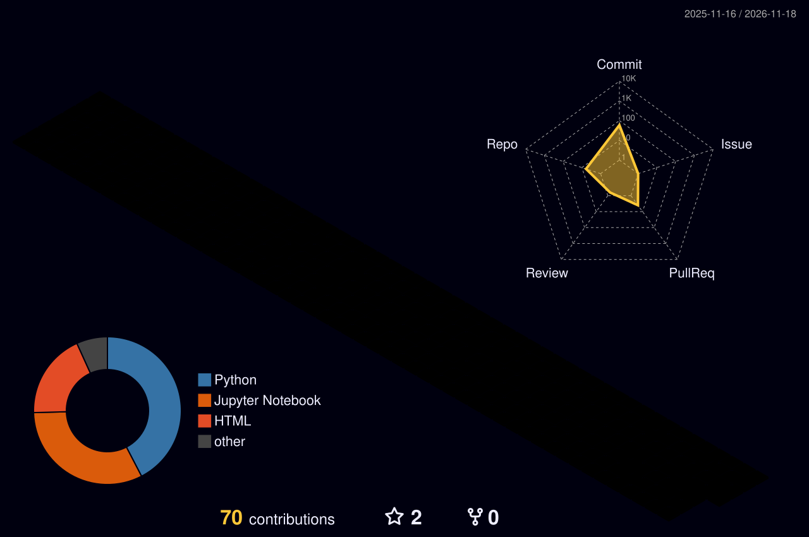

## 💫 Sobre mí

<table>
<tr>
<td width="60%" valign="top">

- 🎹 Estoy construyendo **[Teclamigo](https://github.com/Emanuel2234/teclamigo)**, una app para aprender piano con un teclado MIDI: lee videos tutoriales, saca las notas de un mp3 y arma partituras.
- ☁️ Trabajo con **AWS** y **Google Cloud** (BigQuery, pipelines de datos).
- 📊 Aprendiendo **Big Data** y **Data Science**.
- 🛠️ Me gusta armar herramientas que resuelven problemas reales: monitores de red, dashboards, automatizaciones.
- 💬 Pregúntame sobre Python, PowerShell o cómo pasar un video de piano a MIDI.

</td>
<td width="40%" align="center">

</td>
</tr>
</table>

## 🧰 Tecnologías

**Lenguajes**

**Cloud y datos**

**Herramientas**

## 🚀 Proyectos destacados

| Proyecto | Qué hace | Hecho con |
|---|---|---|
| 🎹 [Teclamigo](https://github.com/Emanuel2234/teclamigo) | Aprende piano con tu teclado MIDI: notas que caen, lectura de videos tutoriales, partitura en PDF y video | JavaScript · Python · Web MIDI |
| 📊 [Causas de muerte en Chile](https://github.com/Emanuel2234/Causas_muerte_chile_2023_2026) | Minería de datos sobre ~408 mil defunciones (DEIS, 2023 a 03/2026): causas principales, edad, regresión, árbol de decisión, K-Means y tasa por región con web scraping | Python · scikit-learn · Power BI |

## 👾 Contribution Space Shooter

## 🌌 Mis contribuciones en 3D

## 💭 Frase del día

